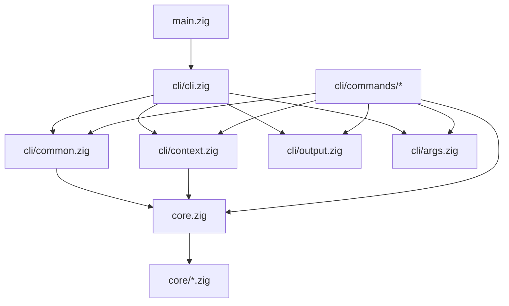

# LowMem module graph

The map of `src/`: who imports whom, what each file is for, and where to
look for a given concern. `test/structure.py --check` fails CI if this map
drifts from the source tree (the file index below must list every
`src/**/*.zig` file exactly once, and the import rules below must hold).

## Module graph

One direction only: `main` → `cli` → `core`. A command never imports
another command; shared command helpers live in `src/cli/` (not in
`commands/`).

## Structural invariants

1. **Dependencies point one way.** `core` imports nothing but itself;
   `cli` imports `core` and other `cli` files; `commands` import `core`
   and `cli` helpers; `main` imports `core`/`cli` only. No cycles.
2. **Core never prints.** No `core` file references `stdout` or `stderr`
   (checked by the gate, comments and string literals excluded). Core
   returns data or errors; the CLI says what it means.
3. **Import through the root.** CLI code imports `core` (the
   re-exporting `src/core.zig`) and never reaches into `src/core/`
   files directly.

## Files

<!-- map:file-index:begin -->
| File | Purpose |
|------|---------|
| `src/main.zig` | Entry: build the process context, hand argv to the dispatcher. Nothing else. |
| `src/core.zig` | Re-exports every core module so the CLI imports one name. |
| `src/cli/cli.zig` | Dispatch: no command → usage; unknown command → refusal; otherwise open the store (except `init`) and run the command. |
| `src/cli/args.zig` | Digit tests, leading-zero normalization, overflow-checked decimal parse (the tool prints digits back verbatim, never recomputes them). |
| `src/cli/common.zig` | What every store command shares: opening the store (or the no-memory refusal), loading sizes, the shared failure voices (block ids, blank/corrupt summaries). |
| `src/cli/context.zig` | The per-process context: I/O backend, allocator, the tool's own path and the store directory, absolute and $HOME-folded. |
| `src/cli/output.zig` | The tool's voice: every line it prints and how a failure is said (one line to stderr, exit 1), the usage block, the no-store refusal. |
| `src/cli/commands/init.zig` | `init`: create whatever is missing, write the default config when absent, print the setup block (Created vs Found). |
| `src/cli/commands/wake.zig` | `wake`: cover(T, WAKE_LINES) rendered and paged; the one refusal — a summary the document needs is not built yet. |
| `src/cli/commands/note.zig` | `note`: validate one line, append it, offer the next nap. |
| `src/cli/commands/nap.zig` | `nap`: print the next pending compression, or pay one (settled → reported, wrong block → refused, race → the other outcome). |
| `src/cli/commands/recall.zig` | `recall`: one streaming pass over the log, keeping only the newest matches that fit PART_CHARS. |
| `src/cli/commands/zoom.zig` | `zoom`: open a node into its two halves, each rendered the way wake renders a covered block. |
| `src/cli/commands/forget.zig` | `forget`: drop a summary and everything built on it (truncate each level to a dense prefix). |
| `src/cli/commands/config.zig` | `config`: show the size knobs, set one, restore a default; rewrites the config file. |
| `src/cli/commands/import.zig` | `import`: bulk-append dated memories from a file, all-or-nothing under the lock. |
| `src/cli/commands/import_optmem.zig` | `import-optmem`: adopt an OptMem store — memories and summaries — into an empty store; source failures are refused before the store is touched. |
| `src/cli/commands/export_optmem.zig` | `export-optmem`: write this memory as an OptMem store (fixed-width LOG.txt and TREE files) into a new or empty directory; all-or-nothing on fit. |
| `src/core/store.zig` | The storage: an append-only variable-length LOG with a compact binary offset index (ADR 0001), the per-level summary files with the same, and the lock. Torn tails are repaired on the next mutation; the index is rebuilt from the log on any mismatch. |
| `src/core/blocks.zig` | Blocks: aligned power-of-two ranges; id parsing (`<lo>-<hi>` inclusive), the buildable-block count. |
| `src/core/cover.zig` | The cover of [0, T) with at most budget aligned blocks — the block set `wake` prints, finest near T. |
| `src/core/nap.zig` | Pending blocks (smallest first, from level lengths only) and the prompt that pays the next one. |
| `src/core/entry.zig` | One memory's text: trim, one line, at most ENTRY_CHARS bytes; which rule broke. |
| `src/core/config.zig` | The size knobs: defaults, the config file's parse and render, the ENTRY_CHARS ceiling. |
| `src/core/ingest.zig` | Import file parsing: `YYYY-MM-DD <text>` lines, real dates, monotone, all-or-nothing with the failing line named. |
| `src/core/optmem.zig` | The OptMem format (320/288-byte records): log and level reads (torn tail skipped, prefix-stop rule), the fit checks, and the all-or-nothing export of a LowMem store. |
| `src/core/date.zig` | Today's local date (for `note`) and calendar validation (for `import`). |
| `src/core/regex.zig` | The recall pattern: a zero-dependency literal subset of the reference engine (`^` anchor, case-insensitive; metacharacters are literal — documented difference 4). |
| `src/core/text.zig` | Pluralization, the reference's exact rule (memory/memories, match/matches, …). |
<!-- map:file-index:end -->

## How to find

- **A command's behavior**: `src/cli/commands/<cmd>.zig` (parse, call
  core, render); the messages it may print are the only prints in the
  file, or in `output.zig`/`common.zig` when shared.
- **A message's wording**: grep for a phrase in `src/cli/`; every
  user-visible string lives in the CLI layer.
- **Storage format**: `src/core/store.zig` plus
  `docs/adr/0001-variable-length-store.md` (record and index layout,
  commit ordering, recovery).
- **What `wake` prints**: `core/cover.zig` (which blocks) +
  `cli/commands/wake.zig` (rendering, paging, the refusal).
- **Pending work**: `core/nap.zig` (`nextPending`, `pendingCount`); the
  prompt text is assembled there.
- **Behavioral spec**: `docs/behavior.md` (commands §4, output rules §6,
  crash semantics §7, concurrency §8, documented differences §9);
  the parity gate is `test/parity.py`, the benchmark harness
  `test/bench.py`.
- **Migration between formats**: `core/optmem.zig` (the format and its
  rules), `cli/commands/import_optmem.zig`,
  `cli/commands/export_optmem.zig`; spec §4.10–4.11.
